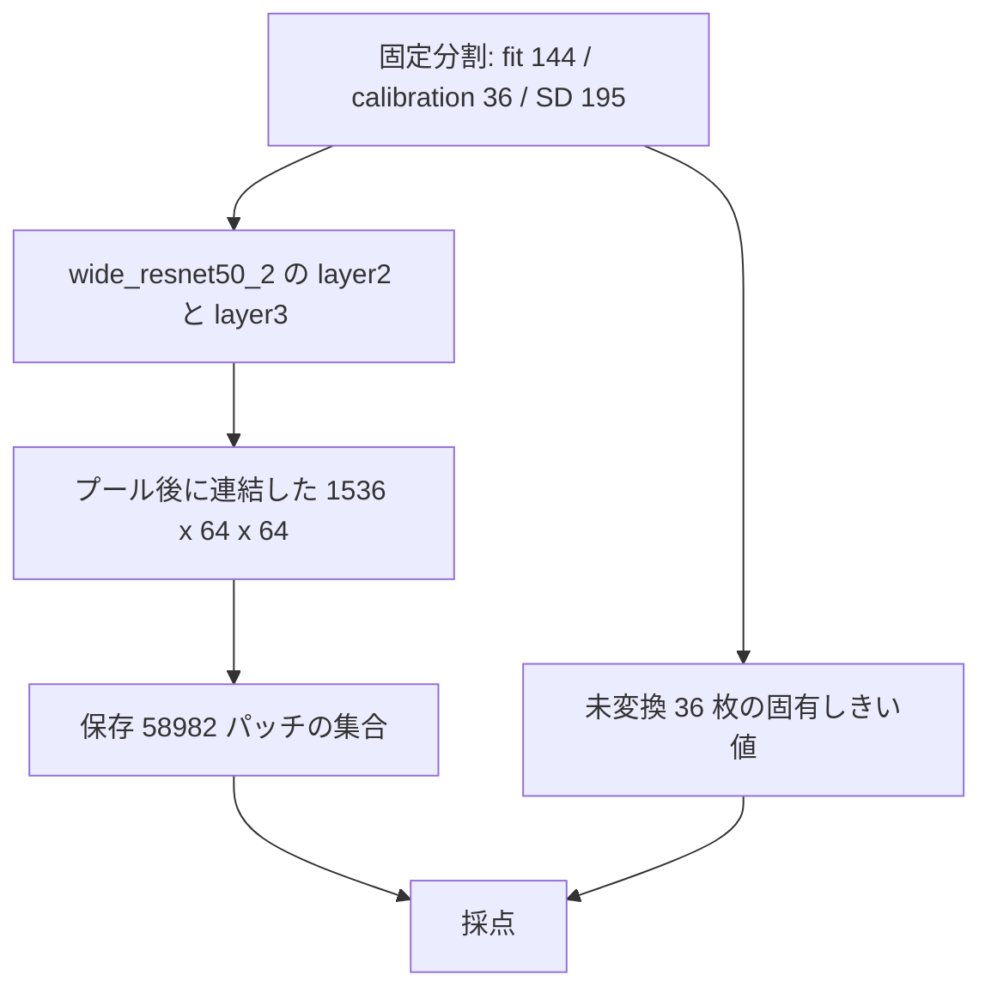
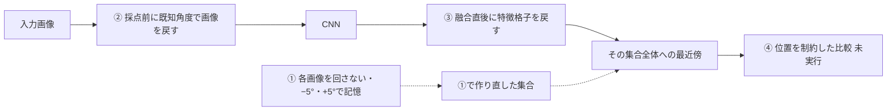
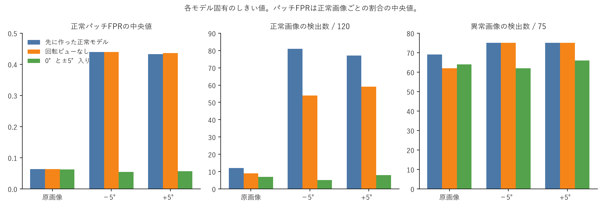
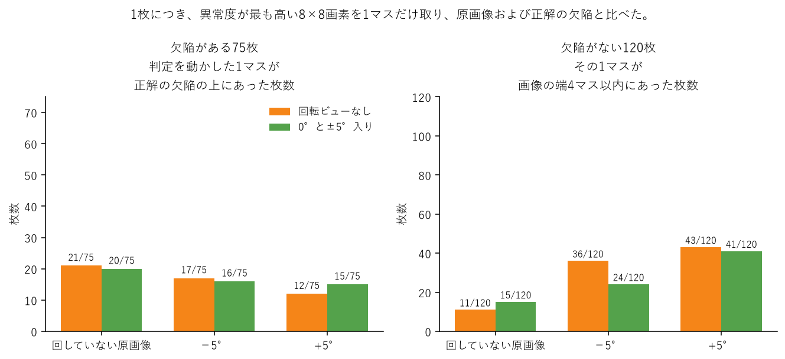
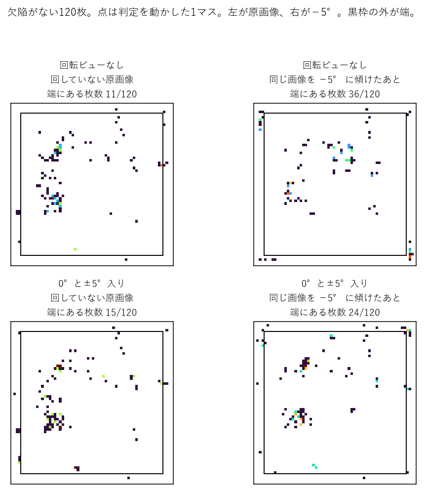
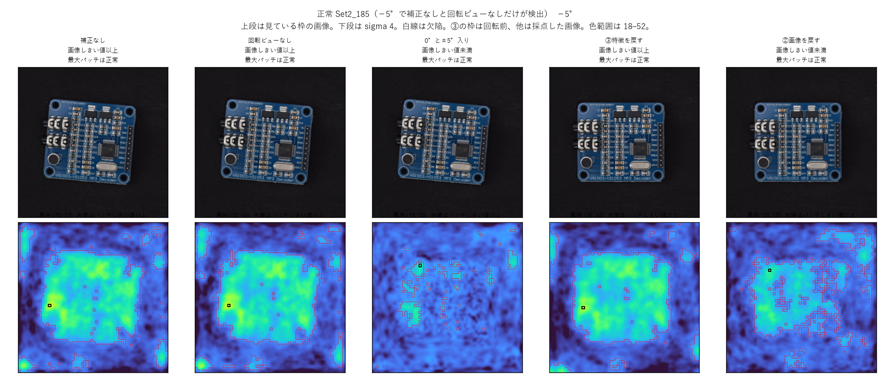
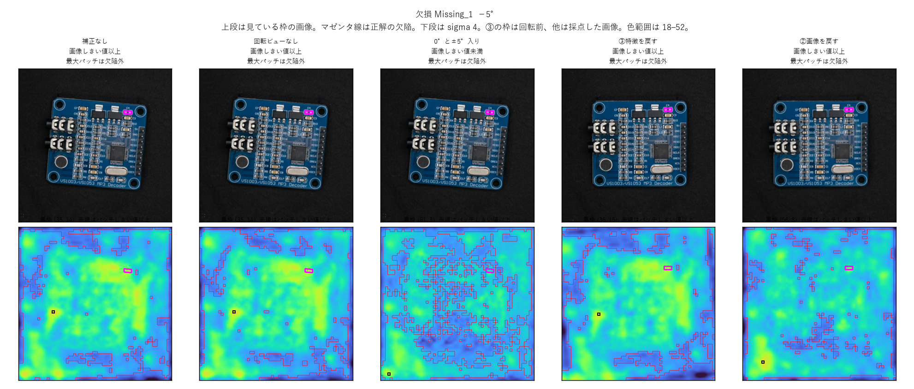
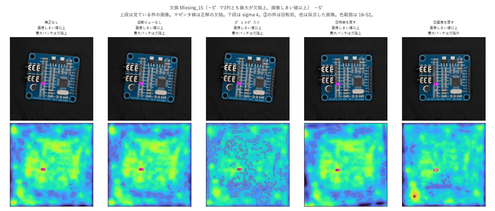
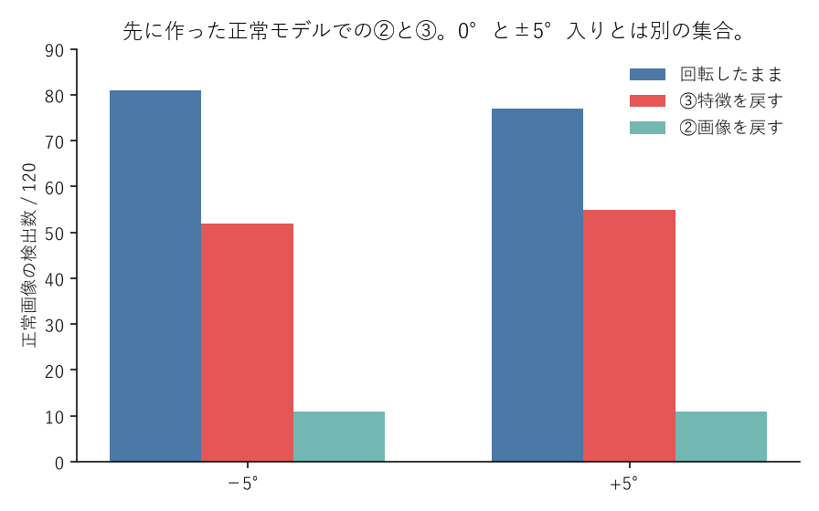

# テーマA 実験レポート

日付: 2026-10-26。判定は未判定。この文書は、固定済みの `results_a0`、`results_a0_boundary`、`results_a0_feature`、`results_a0_augment`、`results_a0_control0` を読み直した報告書である。数値の再計算と、新しい fit はしていない。

## 背景

対象は、固定した特徴抽出器を使う産業用の異常検知である。実装は anomalib 2.7.0 の PatchCore、バックボーンは `wide_resnet50_2`、層は layer2 と layer3 である。入力 512 では、融合後の特徴が 1536 次元の 64×64 になる。1セルは基準画像の 8×8 画素であり、CNN の受容野とは呼ばない。画像スコアは最悪パッチを近傍9個で再重み付けした値、成分の連続値は平滑化前のパッチ最大である。スコアが高いほど異常であり、判定は `score >= threshold` である。

データは PCB である。正常モデルは研究用に固定した fit 144 枚、しきい値は同じ未変換の calibration 36 枚から取る。評価画像は PCB SD テストの 195 枚（正常 120、異常 75、成分 111）である。実撮影フォルダの Rotation ±5% は ±5° ではない。この実験の ±5° は、512 基準座標の中心 (256, 256) で合成した回転である。正の角度は反時計回りである。

回転の共通経路は、端を 22 画素折り返し、角度を最後までかけてから中央 512 を 1 回切る方法である。画像は折り返し、欠陥マスクは外側を 0 で埋める。これは黒埋めより端の混入を抑えた実験条件であり、画像の外の復元でも、境界影響の除去でもない。

研究の問いは、撮影に伴う幾何変動を吸収しながら検出すべき異常を保持するには、どの段階で、どの程度の適応を行うべきか、である。比較の軸はアルゴリズム名ではなく、適応を入れる段階である。番号の定義は次のとおりである。追加学習なしとは、対象データでニューラルネットワークの重みを勾配更新しないことである。角度は既知の合成 ±5° であり、対応点の推定はしていない。テーマB（対応点の推定）とテーマC（追加学習）には進んでいない。

正常モデルとは、正常画像から取り出したパッチ特徴の集合である。検査画像のパッチは、この集合の中で近いものと比べる。この報告に出てくる集合は3つある。

- **先に作った正常モデル**は、テーマAの前に、回さない fit 144 枚だけから保存した集合である。パッチ数は 58,982 である。ファイルは `results_a0` にある。補正なしの採点と、②と③は、この集合を作り直さずに使う。
- **0°と±5°入り**は、①で作り直した別の集合である。
- **回転ビューなし**は、①と同じ作り方で、回さない向きだけを入れたもう一つの集合である。先に作った正常モデルのコピーではない。

番号は、適応を入れる段階である。操作の詳細は、それぞれの実験条件に書く。

- **①** は、正常モデルを作るときに、各画像を回さない向き、−5°、+5° の3通りで記憶する。出来た集合を「0°と±5°入り」と呼ぶ。同じ作り方で回さない向きだけを入れた「回転ビューなし」は、向きを足した効果を見るための比較相手であり、①の実行そのものではない。
- **②** は、先に作った正常モデルを作り直さず、採点の前に検査画像を既知の逆角度で戻す。
- **③** は、先に作った正常モデルと入力の回転を変えず、連結直後の特徴格子を既知の逆角度で戻す。
- **④** は、最近傍を探す範囲を位置で限る段階である。この報告では実行していない。

①の主比較は、回転ビューなしと、0°と±5°入りである。②と③は、先に作った正常モデルを作り直さずに採点した結果である。0°と±5°入りは別のパッチ集合なので、全方式の条件をそろえきった最終順位とは呼ばない。

## 課題

PCB を合成回転すると、正常画像の異常スコアが上がり、画像しきい値を超える枚数と、正常画像ごとのパッチ誤検出率が大きく増える。見ている現象は、正常な基板面の異常度が向きの変化で上がることである。原因は特定していない。欠陥マスクの補集合や、平均輝度で切った内側は、基板面そのものではない。

適応を入れる段階が違うと、正常側の上昇と、傷・欠損・はんだ溶融の検出が別々に動きうる。成分検出は 110/111 付近で飽和しており、この一致だけでは欠陥が保持されたとは読めない。同一画像のパッチや成分を、独立な画像標本にはしない。

モデルを作り直すと、候補順、乱数、射影次元、しきい値が同時に変わりうる。作用点の効果と構築器の差を分けないまま、全方式の順位は付けられない。基板面に限った結論は、確認済み ROI が無いので出せない。

## 目的

想定した ±5° の範囲で、次を分けて測る。

- 補正なしの反射 pad 回転で、正常側の誤検出がどれだけ増えるか
- その増加が、構築器の差だけで説明できるか
- ①として、同じ保存パッチ数のまま 0° と ±5° を正常モデルに入れると、正常側と異常側の正式判定がどう動くか
- ②として、既知の逆回転で画像を戻すと、どこまで戻るか
- ③として、融合後の特徴格子を既知の逆回転で戻すと、画像を戻した場合とどこが違うか

④、未知角度、追加 seed、①②③の組合せは、この報告の実行範囲に入れない。改善幅と同等性の幅は未設定のまま、差を観測として残す。

## 共通の条件

ここから先の①②③に共通する。各実験で変えた箇所は、その実験の「実験条件」に書く。

共通条件は PCB、PatchCore、seed 0 である。fit 144 枚と calibration 36 枚は混ぜない。分位点は `np.quantile(scores, 0.95, method="linear")` で、モデルが変わるたびに未変換 36 枚から取り直す。テスト条件ごとの再校正はしない。fit 画像は校正に入れない。正式な件数は、そのモデル自身の画像しきい値で `score >= threshold` となり、異常と判定した枚数である。成分 110/111 は、入力変換で消えた1件を分母に残した数である。

表の「異常画像」は、欠陥がある 75 枚のうち、異常と判定した枚数である。69/75 は 75 枚中 69 枚を検出した、という意味である。分子が 75 に近いほど、欠陥画像の見逃しは少ない。表の「正常画像」は、欠陥がない 120 枚のうち、同じく異常と判定した枚数である。12/120 は 120 枚中 12 枚の誤検出である。分子が小さいほど、正常画像の誤検出は少ない。どちらも「異常と判定した数」であり、正常と判定した数ではない。この2行は別の望ましい方向を持つので、片方だけを見て優劣にはしない。

正常パッチFPRは、テストの正常画像 120 枚について、1枚の中でパッチしきい値以上になったセルの割合を出し、その 120 個の中央値をとった値である。1枚の格子は 64×64 の 4,096 セルで、1セルは基準画像の 8×8 画素である。セルのスコアは平滑化前の値で、表示用の sigma 4 は入れない。セルがしきい値以上なら、そのセルを誤検出に数える。たとえば 0.440 は、中央にくる正常画像では 4,096 セルのうち約 44% がパッチしきい値以上、という意味である。

パッチしきい値は、未変換の calibration 36 枚の全セルから、目標 0.05 の 0.95 分位点として取る。36 枚 × 4,096 セルは 147,456 セルである。この分位点は校正用であり、テストの 120 枚で 0.05 になることは仮定していない。同じ正常モデルの中では、原画像でも ±5° でもしきい値は変えない。

この割合は、正常画像の検出件数とは別である。正常画像 12/120 は、画像スコアが画像しきい値以上だった枚数である。画像スコアは、その画像で最悪のパッチを近傍 9 個で再重み付けした 1 個の値である。正常パッチFPRは、枚数ではなく、1枚の中のセルの広がりを見ている。4,096 セルを、120 枚とは別の独立な画像としては数えない。異常画像のセルはこの割合に入れない。基板面 ROI は未確認なので、格子の端のセルも分母に残している。

処理の順は次のとおりである。

作用点を入れる場所は次のとおりである。

基板面 ROI は、ファイル名順の正常8枚を `roi_pending/pcb_sd_normal8` に置いたまま未確認である。ヒートマップでは選んでいない。確認前の基板面の数値は出していない。

## ① 正常モデルを作るときに、各画像を3通りの向きで記憶する

### 実験条件

fit の正常画像は 144 枚である。1枚を、次の3通りで特徴にする。

1. 回さない元の画像
2. 端を 22 画素折り返してから、画像中心を軸に −5° 回した画像
3. 同じ手順で +5° 回した画像

144 枚 × 3 通りで、432 枚分の特徴が候補になる。1枚の特徴は 64×64 の 4,096 パッチなので、候補は 1,769,472 個である。向きごとの保存数は決めず、全体から 58,982 個だけを残す。残った内訳は、回さない向きが 21,037、−5° が 19,270、+5° が 18,675 で、どの向きも 144 枚すべてから選ばれている。しきい値は、出来た正常モデルについて、未変換の calibration 36 枚から取り直す。画像しきい値は 37.689、校正上の超過は 2/36 である。出力は `results_a0_augment` である。射影次元は 355 である。

この3通りは、正常モデルを作るときの入力である。検査のときは、1枚の画像を1条件として、この正常モデルと1回だけ比べる。採点した条件は、SD 原画像、反射 pad 0°、反射 pad −5°、反射 pad +5° の4つである。本文と図では、この正常モデルを「0°と±5°入り」と書く。

向きを足した効果を見るため、同じ作り方で回さない向きだけを候補にした「回転ビューなし」も1本作った。ここでのビューは、上の3通りの向きのことである。回転ビューなしは、回す向きを入れていない、という意味である。①の実行そのものではない。出力は `results_a0_control0` である。先に作った正常モデルのコピーでもない。射影次元は 355 に固定し、初期中心は行9列38である。画像しきい値は 37.037、校正上の超過は 2/36 である。

0°と±5°入りの初期点 430,694 は、回さない向きの `Train_PCB_resized_None_None_Normal_Set1_142`、行9、列38 だった。回転ビューなしの同じセルは候補 143,974 である。整数 430,694 は回転ビューなしでは別画像のセルになる。0°と±5°入りの射影行列は保存されていない。回転ビューなしは同じ生成経路で再生成し、SHA-256 を記録した。同一行列とは検証していない。

先に作った正常モデルの画像しきい値は 36.288 で、校正上の超過は同じく 2/36 である。この列は、①で作り直す前の採点である。

### 実験結果

主比較は、回転ビューなしと 0°と±5°入りである。先に作った正常モデルは、作り直す前の件数として左列に置く。下の「異常画像」「正常画像」は、どちらも画像しきい値以上で異常と判定した枚数である。異常画像の行は欠陥がある 75 枚が分母、正常画像の行は欠陥がない 120 枚が分母である。たとえば −5° の 0°と±5°入りは、欠陥画像 62/75 を検出し、正常画像は 5/120 を誤検出している。回転ビューなしの同じ行は、欠陥画像 75/75 を検出する一方、正常画像の誤検出は 54/120 である。検出を残す方向と、誤検出を減らす方向が同時に動いている。

| 条件 | 指標 | 先に作った正常モデル | 回転ビューなし | 0°と±5°入り |
|---|---|---:|---:|---:|
| 原画像 | 異常画像 | 69/75 | 62/75 | 64/75 |
| 原画像 | 正常画像 | 12/120 | 9/120 | 7/120 |
| 原画像 | 正常パッチFPR | 0.064 | 0.064 | 0.062 |
| −5° | 異常画像 | 75/75 | 75/75 | 62/75 |
| −5° | 正常画像 | 81/120 | 54/120 | 5/120 |
| −5° | 正常パッチFPR | 0.440 | 0.440 | 0.054 |
| +5° | 異常画像 | 75/75 | 75/75 | 66/75 |
| +5° | 正常画像 | 77/120 | 59/120 | 8/120 |
| +5° | 正常パッチFPR | 0.433 | 0.436 | 0.057 |

同じ 195 枚の Image AUROC は補助である。原画像は先に作った正常モデル 0.9622、回転ビューなし 0.9618、0°と±5°入り 0.9647。−5° は 0.9488、0.9538、0.9724。+5° は 0.9179、0.9110、0.9790。±5° では 0°と±5°入りの順位指標が上がる一方、正式動作点の異常検出数は回転ビューなしより少ない。

先に作った正常モデルと回転ビューなしの連続スコア差（回転ビューなしから先に作った正常モデルを引いた値）は、原画像の中央値が +0.002、最大絶対差が 2.899 である。最大の画像は正常の Set2_283 で、32.314 と 35.213 である。どちらも両しきい値より下なので、この最大差はその画像の正式判定を動かしていない。校正 36 枚の個別スコアは保存されていない。

原画像では、先に作った正常モデルのスコアへ回転ビューなしのしきい値を当てると正常 9/120、異常 62/75 になり、回転ビューなしの正式件数と一致する。±5° では、この 0.749 のしきい値差で正常件数が 81 から 56、77 から 61 まで動く。パッチ FPR の中央値は 0.440 と 0.436 のままである。0°と±5°入りを回転ビューなしのしきい値で採点しても、正常は 6/120 と 10/120、異常は 65/75 と 71/75 である。交差適用は診断であり、しきい値の選び直しには使っていない。

成分は 110/111、+5° の 0°と±5°入りだけ 109/111 で、落ちた1件は面積1の成分である。

構築、校正、採点の時間と保存量は次である。先に作った正常モデルの同じ3区間の計測は残っていない。

| 実験 | 構築 | 校正 | 採点 | 保存バイト |
|---|---:|---:|---:|---:|
| 回転ビューなし | 514.2秒 | 12.1秒 | 191.4秒 | 397,459,530 |
| 0°と±5°入り | 1,520.5秒 | 12.9秒 | 196.2秒 | 397,484,856 |
| 先に作った正常モデル | 同じ3区間の計測は残っていない | | | 395,883,637 |

0°と±5°入りの GPU ピークは、抽出 242,250,240 バイト、k-center 5,171,395,584 バイトである。回転ビューなしは、抽出が同じ 242,250,240 バイト、k-center が 1,811,758,080 バイト、校正 877,073,408 バイト、採点 918,029,312 バイトである。パッチ集合のファイルはいずれも約 362MB である。

調べたのは、画像を異常と判定したとき、その判定が正解の欠陥を見ているかどうかである。画素を1つずつ誤検出として数えた調査ではない。1枚につき、異常度が最も高い 8×8 画素を1マスだけ取り、その位置を見た。比べたのは、回していない原画像と、同じ画像を −5° または +5° に傾けたあとである。モデルは、回した向きを入れない回転ビューなしと、入れた 0°と±5°入りの2つである。

欠陥がある 75 枚では、その1マスを正解の欠陥マスクと比べた。重なっていれば、画像判定を動かした場所は欠陥の上である。回していない原画像でも重なるのは、回転ビューなし 21/75、0°と±5°入り 20/75 である。−5° では 17/75 と 16/75、+5° では 12/75 と 15/75 である。原画像と比べて、傾けたあとにも、向きを正常モデルに入れても、この重なりは増えていない。75枚の多くでは、欠陥の外の1マスが画像判定を動かしている。

欠陥がない 120 枚には正解の欠陥が無い。同じ1マスが画像の端4マス以内にあった枚数を、原画像と比べた。原画像では回転ビューなし 11/120、0°と±5°入り 15/120 である。−5° に傾けると 36/120 と 24/120、+5° では 43/120 と 41/120 になる。向きを入れないモデルでは、傾けると判定の場所が端へ寄る。−5° では、向きを入れたモデルのほうが端は少ない。+5° では 43 と 41 で、ほとんど変わらない。

下の点の図は、欠陥がない 120 枚だけである。左列が回していない原画像、右列が同じ画像を −5° に傾けたあとである。色の点1つが、その画像を異常と言わせた1マスである。黒枠の外が画像の端である。正解の欠陥は無いので、マゼンタは出ていない。

このあとの写真は、上の枚数を1枚に戻した例である。上段が基板の写真、下段がその写真の上の異常度である。暖色ほど異常度が高い。黒枠が、画像判定を動かした1マスである。欠陥がある画像では、正解の欠陥をマゼンタで塗っている。黒枠とマゼンタが重なれば、その1枚は欠陥の上を見て異常と言っている。列は5つある。①で見比べるのは左から2列目の回転ビューなしと、3列目の 0°と±5°入りである。

Set2_185 は、欠陥が無い基板を −5° に傾けた1枚である。正解の欠陥は無い。2列目の回転ビューなしは、基板の広い範囲で異常度が高く、画像を異常と判定している。3列目の 0°と±5°入りは、異常度が高い範囲がまばらで、画像しきい値未満である。この1枚は、−5° の正常画像の誤検出が 54/120 から 5/120 へ動いたうちの1枚であり、120枚の代表ではない。

Missing Component_1 は、欠陥がある基板を −5° に傾けた1枚である。マゼンタが正解の欠陥である。黒枠はどの列もマゼンタの外にある。この1枚を異常と言わせている場所は、正解の欠陥ではない。2列目は画像しきい値以上、3列目は未満である。3列目で下がったのは、欠陥の外にある基板面の異常度である。欠陥の内側の最大は 31.51 で、その列のパッチしきい値 25.81 以上のままである。75枚の代表ではない。

Missing Component_15 は、黒枠とマゼンタが重なった例である。−5° で、2列目も3列目も、判定を動かした1マスが正解の欠陥の上にあり、画像しきい値以上である。補正なし、回転ビューなし、0°と±5°入りの3つがそろってこうなる画像は 12/75 ある。ファイル名順の最初がこの1枚で、ヒートマップを見て選んではいない。画像スコアは回転ビューなし 45.53、0°と±5°入り 41.44 である。75枚の代表ではない。

事前に固定した正常 Set2_181 は、−5° では5列とも画像しきい値未満である。この1枚は誤検出の例ではない。それでも補正なしと回転ビューなしでは基板面の広い範囲で異常度が高く、0°と±5°入りでは異常度が高い範囲がまばらである。図は `report_figures/theme_a/loc_m5_Test_PCB_resized_None_None_Normal_Set2_181.png` にある。傷 Scratch_20 の −5° も、5列とも最大パッチは欠陥の外にある。

これらの図は基板面 ROI ではない。ヒートマップを見て ROI は選んでいない。

## ② 採点の前に、検査画像を既知の逆角度で戻す

### 実験条件

比べるパッチの集合は、先に作った正常モデルのままである。②ではその集合を作り直さない。しきい値も、画像 36.288、パッチ 24.216 のままである。

変えるのは検査画像である。ImageNet 正規化の前の RGB を、既知の逆角度で元の向きへ戻してから CNN に入れる。実行したのは、端を折り返して −5° 回転したあと +5° で戻す往復と、その逆である。角度の推定器は作らない。出力は `results_a0_boundary` の画像往復である。

比べる相手は、同じ先に作った正常モデルで、戻さずに採点した反射 pad −5° と +5° である。戻したあとの枠は、回転前の画像の枠である。

### 実験結果

| 条件 | 異常画像 | 正常画像 | 正常パッチFPR | 成分 |
|---|---:|---:|---:|---:|
| 戻さず −5° | 75/75 | 81/120 | 0.440 | 110/111 |
| 戻さず +5° | 75/75 | 77/120 | 0.433 | 110/111 |
| ② 画像を戻す −5° | 75/75 | 11/120 | 0.257 | 110/111 |
| ② 画像を戻す +5° | 74/75 | 11/120 | 0.250 | 110/111 |

正常検出は、戻さないときの 81/120 と 77/120 から、11/120 と 11/120 になる。異常画像は 75/75 と 74/75 である。正常パッチ FPR の中央値は 0.257 と 0.250 である。成分はどちらも 110/111 である。

検出位置では、戻したあとの枠で、正常 120 枚の最大パッチが外周 4 セル以内にある枚数は 9 枚と 7 枚である。異常 75 枚で、最大パッチの 8×8 が欠陥マスクに重なる枚数は、−5° の往復が 17、+5° の往復が 15 である。Set2_185 の −5° では、②の列は画像しきい値未満で、異常度が高い範囲は③の列より狭い。図は①の実験結果にある `loc_m5_split_Normal_Set2_185.png` の一番右の列である。

この件数は、0°と±5°入りとの順位にはしない。比べているパッチの集合が違う。②の採点時間は、この報告では分けて残していない。

## ③ 連結直後の特徴格子を、既知の逆角度で戻す

### 実験条件

比べるパッチの集合は、②と同じく先に作った正常モデルのままである。入力画像にかけた回転も変えない。しきい値は、画像 36.288、パッチ 24.216 のままである。

戻す位置は、`generate_embedding` の直後、`reshape_embedding` の前である。対象は、layer2 と layer3 を連結した直後の 1536 次元、64×64 の特徴格子である。画像を −5° したときは特徴を +5°、画像を +5° したときは特徴を −5° 戻す。融合前の layer2 と layer3 は、別々には回さない。特徴の補間は bilinear、`padding_mode="reflection"`、`align_corners=False` である。±5° では 232/4096 セルが反射参照になる。画像判定はこのセルを含む。採点は 195 枚 × 2 条件の 390 回である。出力は `results_a0_feature` である。

比べる相手は、同じ先に作った正常モデルで、特徴を戻さずに採点した反射 pad −5° と +5° である。③の特徴格子は回転前の枠にあり、②の往復で画像を戻してから特徴を取り直した結果とは別である。成分マスクの枠も、③と戻さない採点とで違う。

### 実験結果

| 条件 | 異常画像 | 正常画像 | 正常パッチFPR | 成分 |
|---|---:|---:|---:|---:|
| 戻さず −5° | 75/75 | 81/120 | 0.440 | 110/111 |
| 戻さず +5° | 75/75 | 77/120 | 0.433 | 110/111 |
| ③ 特徴を戻す −5° | 75/75 | 52/120 | 0.413 | 110/111 |
| ③ 特徴を戻す +5° | 75/75 | 55/120 | 0.409 | 110/111 |

上の正常検出の図では、③は中央の棒である。ファイルは `report_figures/theme_a/bars_oldbank_normal.png` である。

正常検出は 52/120 と 55/120 である。戻さないときの 81/120 と 77/120 より 29 枚と 22 枚少ない。②の 11/120 までは戻っていない。異常画像はどちらも 75/75 である。正常パッチ FPR の中央値は 0.440 から 0.413、0.433 から 0.409 で、低下は 0.027 と 0.024 である。成分はどちらも 110/111 である。

異常 75 枚では、戻さない採点との画像スコア差の中央値が −1.12 と −0.90、成分最大の差の中央値が −0.68 と −0.82 である。両方低下した画像はどちらも 65/75 である。成分差には、マスクの枠の違いが混ざる。

検出位置では、異常 75 枚のうち最大パッチが欠陥に重なる枚数は −5° で 20、+5° で 15 である。③の枠は回転前なので、回転した画像の外周割合とは並べない。Set2_185 の −5° では、③の列でも基板面の広い範囲で異常度が高い。図は①の実験結果にある同じファイルの、右から2番目の列である。③のヒートマップは回転前の画像に重ねている。

採点は 180.3 秒、保存は 9,120,753 バイトである。正常モデルの構築と校正は、先に作った正常モデルのものを使っている。この件数は、0°と±5°入りとの順位にはしない。

## 考察

### ①

回転ビューなしでは、回転時の正常パッチ FPR 上昇が先に作った正常モデルと同程度に残る。同じ保存パッチ数の0°と±5°入りでは、その上昇が抑えられる。したがって、この上昇は新しい構築器だけが作ったものではない。回した向きを正常モデルへ入れたことと一緒に動いている。

回転条件の正式動作点では、0°と±5°入りは回転ビューなしより正常誤検出も異常画像検出も少ない。原画像では、0°と±5°入りの異常検出 64/75 は回転ビューなしの 62/75 より少なくない。回転画像だけで異常検出が落ちたのであり、原画像を含む全般的な感度喪失とは読んでいない。最良、同等、欠陥保持の証明とも呼ばない。成分は 110/111、+5° の0°と±5°入りだけ 109/111 で、落ちた1件は面積1の成分である。飽和に近い件数は、欠陥が残った証拠にしない。

異常画像では、最大パッチが欠陥マスクに重なるのは 75 枚中 12 枚から 20 枚である。画像判定を動かしている場所は、多くの枚で欠陥の外にある。成分検出が 110/111 付近なのは、欠陥の内側の最大が別にあるからである。Missing Component_1 の −5° も、黒枠は全列で欠陥の外にあり、0°と±5°入りでも欠陥の内側はパッチしきい値以上である。その列で落ちたのは画像判定で、基板面で異常度が高い範囲が狭くなり、画像スコアが 40.7 付近から 36.17 へ下がったことによる。欠陥の上に異常度が残り、3列とも画像しきい値以上になった例は Missing Component_15 で、−5° では 12 枚ある。

原画像の、先に作った正常モデルと回転ビューなしの正式件数の差は、連続スコアの中央値がほぼ0であることと、しきい値が 0.749 上がったことと揃う。±5° のパッチ FPR は、そのしきい値差では消えない。0°と±5°入りの正常件数は、回転ビューなしのしきい値へ交差適用しても 6/120 と 10/120 のままである。

### ②

先に作った正常モデルを作り直さずに画像を戻すと、正常検出は 11/120 まで戻る。Set2_185 の −5° では、②の列は画像しきい値未満で、異常度が高い範囲は③より狭い。この件数は、0°と±5°入りとの順位にはしない。比べているパッチの集合が違う。

### ③

同じ先に作った正常モデルで特徴格子を戻すと、正常検出は 52/120 と 55/120 で、②の 11/120 までは戻らない。パッチ FPR の低下は 0.027 と 0.024 にとどまる。Set2_185 の −5° では、③の列でも基板面の広い範囲で異常度が高い。特徴格子を戻す操作は、画像を戻してから特徴を取り直す操作とは別の結果になる。この件数も、0°と±5°入りとの順位にはしない。

基板面 ROI が未確認なので、①②③のいずれでも、パッチ FPR の低下を基板面の過反応改善とは呼ばない。正常パッチの分布と、欠陥成分の最大は別の要約である。代表値の大小だけで欠陥保持は結論しない。

④で次に見る問いは、向きを増やさずに比較の位置を制約すると、回転時の正常パッチ FPR がどこまで下がるか、そのとき異常画像の正式動作点が補正なしの 75/75 からどう動くか、である。半径は検出率を見て選ばない。この報告では実行していない。

## 結論

結論は、想定した ±5° についての3つである。各項目では、欠陥がない 120 枚を異常と判定した枚数を先に書き、そのときの欠陥がある 75 枚の検出数を続ける。①②③の順位は付けない。判定は未判定のままである。

### ① 想定した向きを、正常モデルに入れる

比べたのは、回した向きを入れない回転ビューなしと、0°・−5°・+5° を入れた 0°と±5°入りである。テスト画像を ±5° 傾けたとき、欠陥がない画像の誤検出は減った。−5° は 54/120 から 5/120、+5° は 59/120 から 8/120 である。正常パッチFPRは、欠陥がない画像 1 枚ごとに、64×64 セルのうちパッチしきい値以上だった割合を出し、その 120 枚の中央値を取った値である。この中央値も、−5° が 0.440 から 0.054、+5° が 0.436 から 0.057 へ下がった。

0°と±5°入りの画像しきい値 37.689 は、回転ビューなしの 37.037 より高い。誤検出の減少は、このしきい値の差だけでは説明できない。0°と±5°入りのスコアを 37.037 で数え直しても、欠陥がない画像の誤検出は −5° で 6/120、+5° で 10/120 である。

欠陥がある画像の検出は、同じ ±5° で 75/75 から −5° の 62/75、+5° の 66/75 へ減った。この減少は、傾けた画像で起きている。回していない原画像の検出は、0°と±5°入りが 64/75、回転ビューなしが 62/75 である。正常モデルに入れていない角度で同じことが起きるかは、まだ見ていない。

### ② 角度が分かっているとき、特徴を取る前に画像を戻す

先に作った正常モデルは作り直していない。検査画像を、分かっている逆角度で戻してから特徴を取ると、欠陥がない画像の誤検出は −5° の 81/120 と +5° の 77/120 から、どちらも 11/120 になった。回していない原画像では、同じモデルの誤検出は 12/120 である。欠陥がない画像を異常と判定するかどうかは、回転前に近い。

欠陥がある画像の検出は −5° で 75/75、+5° で 74/75 である。原画像の 69/75 より多い。正常パッチFPRの中央値は 0.257 と 0.250 で、原画像の 0.064 より高い。角度を推定してから同じ操作をした場合は、まだ見ていない。

### ③ 連結直後の特徴を、分かっている角度で逆に回す

②と同じ正常モデルで、画像の回転はそのまま、連結直後の特徴格子だけを逆に回した。欠陥がない画像の誤検出は、−5° が 81/120 から 52/120、+5° が 77/120 から 55/120 へ減った。②の 11/120 より多い。

正常パッチFPRの中央値は −5° が 0.413、+5° が 0.409 である。逆に回す前は 0.440 と 0.433 なので、中央の画像では約 4 割のセルがパッチしきい値以上のままである。欠陥がある画像の検出は、どちらも 75/75 である。

この操作は、固定した CNN が連結した直後の特徴を、空間的に逆回転しただけである。学習で位置を合わせる方法や、別の層を戻す方法は、ここでは動かしていない。

3つを続けて書くと、次のとおりである。想定した ±5° では、正常モデルにその向きを入れると、欠陥がない画像の誤検出は減り、傾けた欠陥画像の検出も 62/75 と 66/75 へ減った。特徴を取る前に画像の向きを戻すと、欠陥がない画像の誤検出は 11/120 になり、欠陥がある画像の検出は 75/75 と 74/75 だった。連結直後の特徴を後から回すと、欠陥がない画像の誤検出は 52/120 と 55/120 まで減るが、正常パッチFPRの中央値は約 0.41 のままである。

## まとめ

上の結論は、PCB、PatchCore、seed 0、合成した ±5° に限る。①の正常モデルと、②③の正常モデルは別なので、3つの件数を並べた順位にはしない。判定は未判定である。0°と±5°入りと回転ビューなしの射影行列が同じかは未検証である。校正 36 枚の1枚ずつのスコア差は保存されていない。基板面の範囲は未確認なので、正常パッチFPRの低下を基板面の改善とは呼ばない。④、方式の組合せ、上以外の角度、別の seed、角度の推定、追加学習は実行していない。
