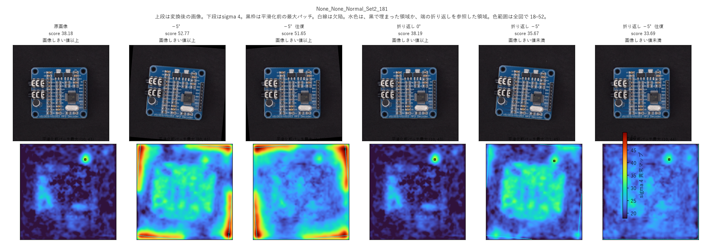
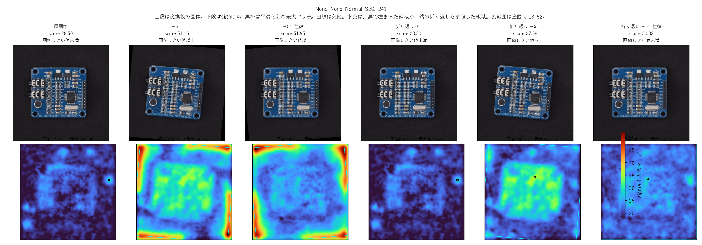
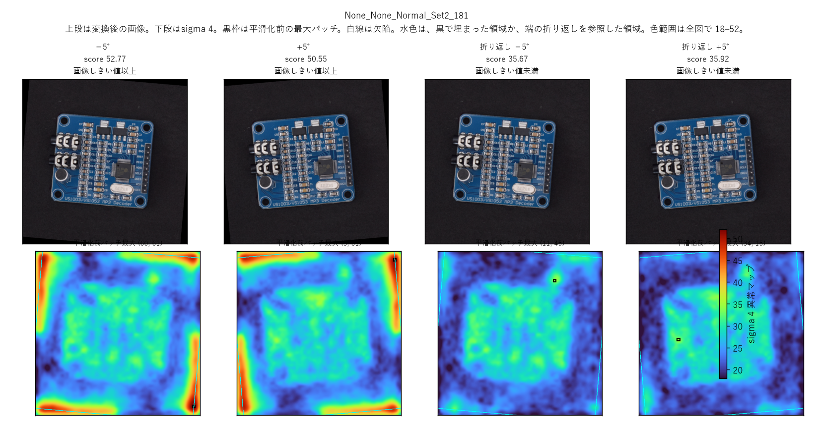
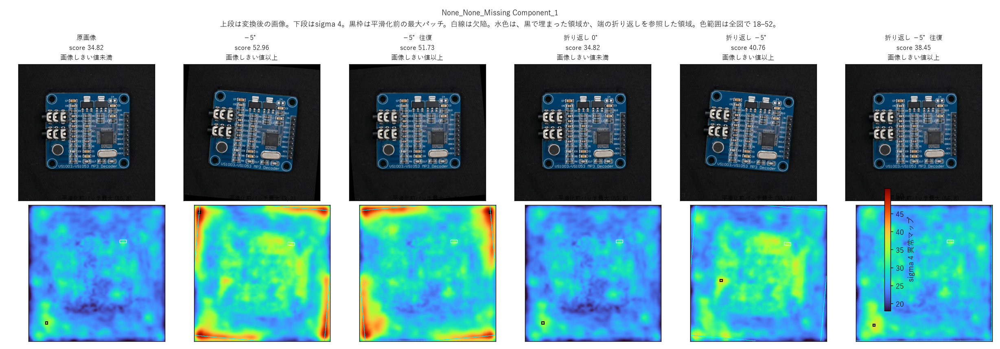
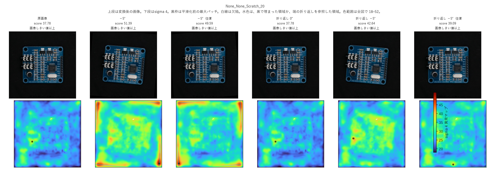

# 実験レポート

対象は、RobustAD の PCB に対する PatchCore である。再現の表は `REPORT.md`、準備Pの診断は `P_REPORT.md` に残してある。この文書は、そのあと実行した研究用144枚 fit、合成回転6条件、端を折り返して埋めた比較を、数値と検出位置の両方でまとめる。

判定は未判定のままである。実用的改善、同等、既知変換による性能上限、真の画像外情報の復元、境界影響の完全除去とは呼ばない。

## 固定した条件

fit は PCB、PatchCore、seed 0、正常144枚を1回だけである。校正は未変換の正常36枚で、変換ごとの再fit と再校正はしていない。画像しきい値は 36.288、パッチしきい値は 24.216 で、どちらも `np.quantile(scores, 1-0.05, method="linear")` である。判定は `score >= threshold`、同点は異常である。主画像スコアは再現互換の再重み付けスコアで、成分の主統計量は平滑化前パッチ格子の最大である。表示用の異常マップは、その格子を 512 へ上げてから sigma 4 で平滑化したものである。画像スコアとしきい値判定は、この平滑化マップの最大ではない。

角度 −5° と +5° は、この合成実験の設定値である。実撮影 Rotation のファイル名 `±5%` は `±5°` と解釈しておらず、そのフォルダは使っていない。元画像は PCB SD の195枚（正常120、異常75、成分111）である。512化で消えた `Scratch_27` の成分3は、分母111に残している。

準備Pでは、seed 0・入力512・正常180枚の診断7ドメインが `results_a1` と画像 AUROC・画素 AUROC とも差 0 だった。その一致は、144枚モデルの採否には使っていない。

## 合成回転の6条件

出力は `results_a0`。メモリバンクは `(58982, 1536)` の float32 で、保存して再利用した。

| 条件 | 異常画像 | 正常画像 | 画像ごとの正常パッチFPR中央値 | 成分 |
|---|---:|---:|---:|---:|
| 原画像・0°ワープ | 69/75 | 12/120 | 0.064 | 110/111 |
| 合成 −5° | 75/75 | 120/120 | 0.739 | 110/111 |
| 合成 +5° | 75/75 | 120/120 | 0.733 | 110/111 |
| −5°を +5°で戻す | 75/75 | 120/120 | 0.661 | 110/111 |
| +5°を −5°で戻す | 75/75 | 120/120 | 0.657 | 110/111 |

0°ワープは195枚すべてで原画像と画像スコアが一致した。回転4条件では正常のスコア分布が異常と重なり、正常の p10 は 48.6 以上で画像しきい値 36.288 を超える。異常画像の検出数が 69 から 75 へ増えた対差は +0.080 である。この増加を改善とは呼ばない。正常120枚がすべてしきい値以上になるからである。

±5°では、正常120枚の平滑化前最大パッチがすべて、黒（値0）と混ざった四隅に接する。回転で欠けた画素を0で埋めると、そこに余分なエッジが出て異常になる。これは想定どおりであり、回転で欠ける画素には埋め方を考える必要がある、で確定とする。

成分検出 110/111 は6条件で一致し、この195枚での検出不一致は 0 件である。これは観測上の一致であり、未知画像への同等性ではない。対差の幅が 0 になる区間も、同等性の根拠にしていない。成分最大の連続値は、画像1枚につき1個の最大として見ると、−5°で原画像との差の平均が +3.68（75枚の最小 −2.13、最大 +8.92）である。全パッチを独立標本にした区間は付けていない。

## 端を折り返して埋めた比較

512画素の画像の外側に、端の画素を鏡のように折り返した22画素を足す。一辺556画素の画像のうえで回転を済ませ、最後に中央の512画素だけを切り出す。512のまま回すと四隅は値0の黒になる。この比較は、その黒の代わりに折り返した端が入るようにしたものである。

出力は `results_a0_boundary`。同じバンク、同じ二つのしきい値を使った。再fit と再校正はしていない。22px は、回転を順にかけたあとでも中央512に黒が混ざらない幅であり、検出率では選んでいない。実行前の確認で、中央に黒が混ざった画素は 0 のままだったので、幅は変えていない。

外側を足して中央を切り出すだけで回転しない経路は、元画像と最大絶対差 0 だった。そこに 0°の再標本を入れると、実画像 `Normal_Set2_181` で最大絶対差 1.89e-5、平均絶対差 1.62e-7 だった。非対称な印の画素は動かず、+5°は上へ移った。

| 条件 | 異常画像 | 正常画像 | 画像ごとの正常パッチFPR中央値 | 成分 |
|---|---:|---:|---:|---:|
| 折り返し 0° | 69/75 | 12/120 | 0.064 | 110/111 |
| 折り返し −5° | 75/75 | 81/120 | 0.440 | 110/111 |
| 折り返し +5° | 75/75 | 77/120 | 0.433 | 110/111 |
| 折り返し −5°往復 | 75/75 | 11/120 | 0.257 | 110/111 |
| 折り返し +5°往復 | 74/75 | 11/120 | 0.250 | 110/111 |

四隅を黒で埋めた合成回転と比べると、正常の画像スコアは ±5°で平均 −13.4 と −12.8、往復で平均 −18.3 と −18.9 下がった。正常画像の検出不一致は、±5°で 39/120 と 43/120、往復で 109/120 である。黒埋めの方はしきい値以上で、端を折り返した方はしきい値未満、という向きである。

折り返し 0°を基準にすると、往復の正常検出数は 11/120 と 12/120 で、不一致は 5枚である。画像ごとの正常パッチFPRの中央値は 0.064 から 0.25 へ上がったままである。検出数の近さと、パッチ比率の差は別である。±5°では中央の約4.2%の画素が折り返した端を参照し、往復では約0.8%である。黒が混ざっていないことと、画素が元の正方形だけから来ていることは別である。

成分検出の不一致は、この195枚では元条件との間でも折り返し 0°との間でも 0 件である。画像単位の成分最大は、黒埋めの回転とほぼ同じ高さに留まった。

回転を戻したときのわずかな位置ずれは、回転で画素の解像度が足りず、量子化の劣化が乗るものとして、ここでは追わない。

## 見るところ

気にするのは、回転そのもので基板の異常度が上がることである。四隅の黒エッジではない。

正常120枚について、元画像で平均輝度が 0.12 を超える範囲を基板とし、その輪郭から24画素内側にあるパッチの平均を取った。この切り方は図を読むためのもので、しきい値や幅を検出率で選んではいない。

| 条件 | 基板の内側のパッチ平均（120枚の中央値） |
|---|---:|
| 原画像 | 21.4 |
| 黒埋め −5° | 28.9 |
| 折り返し −5° | 28.9 |
| 折り返し +5° | 28.2 |
| 折り返し −5°往復 | 24.9 |

折り返し −5°と黒埋め −5°は、基板の内側ではほぼ同じである。端の埋め方を変えても、内側の上昇は残る。原画像の 21.4 はパッチしきい値 24.2 の下にあり、±5°の 28.9 と 28.2 はその上にある。ヒートマップで基板全体が明るく見えるのは、この上昇である。

## 検出位置

図は、ファイル名順の正常の先頭と中央、異常の先頭と中央である。スコアの高低では選んでいない。

- 正常: `Normal_Set2_181`、`Normal_Set2_241`
- 異常: `Missing Component_1`、`Scratch_20`

各図の上段は変換後の画像、下段は sigma 4 の異常マップである。色範囲は全図で 18–52。黒枠は平滑化前パッチ格子の最大セル（8×8画素）である。白線は512化した欠陥、水色は黒で埋まった領域か、端の折り返しを参照した領域である。画像スコアは黒枠のセル値とほぼ同じ位置に出る。これは再重み付けスコアが、最悪パッチの距離に沿っているためである。

`Set2_181` は、この選択規則で先頭に来た正常であり、原画像の時点でスコア 38.18、最大セル `(10, 43)` である。12/120 の誤検出の1枚にあたる。−5°では最大セルが `(60, 61)`、+5°では `(3, 61)`、往復でも隅のセルになり、スコアは 50 を超える。ヒートマップは四隅と基板の縁が赤く、基板の内側も原画像より暖かい。折り返し −5°では最大セルが `(11, 45)` に戻り、スコアは 35.67 でしきい値未満になる。往復も `(10, 44)` 付近へ戻り、スコアは 33.69 である。隅の赤いピークは消える一方、基板の輪郭に沿った四角い暖色は残る。

`Set2_241` の原画像はスコア 28.50、最大セル `(24, 59)` で、しきい値未満である。四隅を黒で埋めた −5°、+5°、往復は、最大セルが `(60, 61)`、`(3, 61)`、`(3, 2)`、`(2, 3)` と四隅に移り、スコアは 51–54 になる。折り返し −5°では最大セルが基板内側の `(22, 33)` になり、スコア 37.58 でしきい値以上のままである。隅を最大にしなくても、内側の応答だけで画像判定が超える例である。折り返しの往復はスコア 30.82 でしきい値未満に戻るが、ヒートマップの四角い縁は原画像より暖かい。

`Set2_181` の −5°と +5°は、赤いピークが右下と右上に分かれる。折り返しの −5°と +5°は、どちらも隅の赤いピークが消え、スコアは 35.67 と 35.92 でどちらもしきい値未満である。最大セルの位置は `(11, 45)` と `(34, 15)` で同じではない。符号で隅の向きは変わり、端を折り返したあとにも最大セルは一箇所に固定されない。

`Missing Component_1` は異常ファイル名の先頭である。原画像のスコアは 34.82 でしきい値未満、最大セルは `(55, 8)` で、白線の欠陥とは重ならない。6枚増えた異常検出の1枚がこれにあたる。四隅を黒で埋めた回転と往復では最大セルが四隅に移り、スコアは 51–53 になる。欠陥との重なりはない。折り返し −5°はスコア 40.76 でしきい値以上になり、最大セルは `(35, 14)` で、やはり欠陥と重ならない。折り返しの往復は最大セルが `(56, 8)` と `(57, 9)` で、原画像の最大セルの隣に戻る。スコアは 38.45 と 39.74 でしきい値以上のまま、欠陥とは重ならない。この1枚では、画像判定が超えても、最も熱いパッチは注釈した欠品の上に来ていない。

`Scratch_20` は異常の中央である。原画像のスコアは 37.78 でしきい値以上だが、最大セル `(39, 17)` は白線の傷と重ならない。四隅を黒で埋めた4条件は最大セルが隅で、傷とも重ならない。折り返しの −5°は `(36, 14)` で傷と重ならず、+5°の `(17, 34)` だけがこの4枚×表示条件のうち傷と重なった。折り返しの往復は最大セルが下端の `(61, 32)` と `(60, 32)` で、傷とは重ならない。ヒートマップ上の白線の周囲が、周囲の基板より特に赤い、という見え方にはなっていない。

図の四隅が赤くなるのは、欠けた画素を黒で埋めたときのエッジである。端を折り返すと、そのピークは弱まる。そのあとにも基板全体が原画像より明るいのは、上の表の内側の上昇と同じである。`Set2_241` の折り返し −5°は、最大セルが基板内側の `(22, 33)` のまま画像しきい値を超える。欠品と傷の白線は、その明るい基板の中で特別に赤い位置にはなっていない。4枚はファイル名規則で選んだ例であり、75枚全体の重なり率ではない。

## ここまでで置いてあるもの

- 再現: `REPORT.md`、`results_a1`
- 準備P: `P_REPORT.md`、`P_DECISIONS.md`、`results_p0`
- 合成回転: `A_MINIMAL_RESULT.md`、`results_a0`
- 端の折り返し: `A_BOUNDARY_RESULT.md`、`results_a0_boundary`
- このレポートの図: `report_figures/theme_a`

追加のパディング、幅、角度、seed は試していない。
