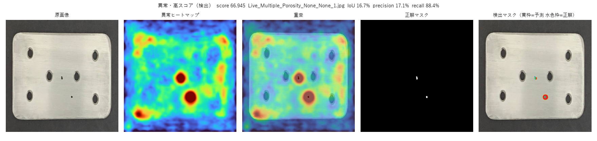
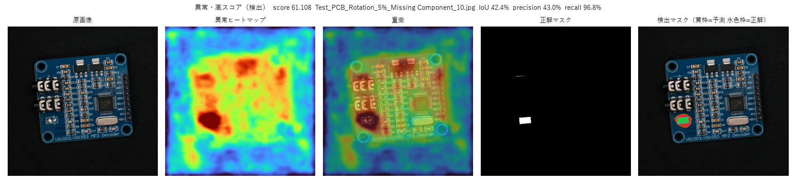
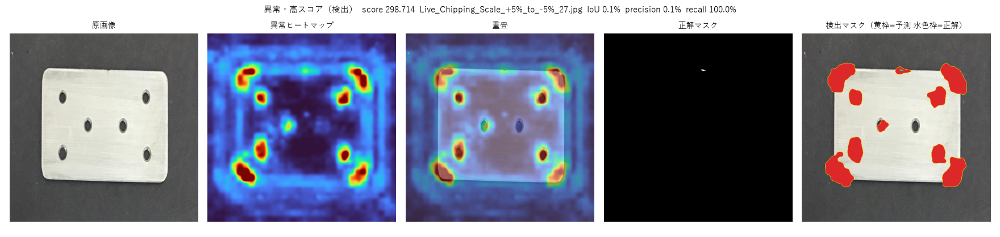
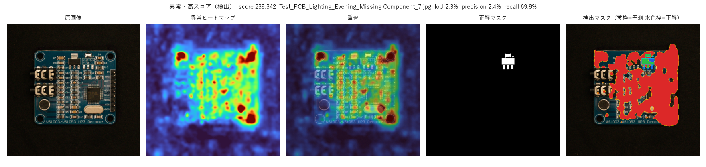
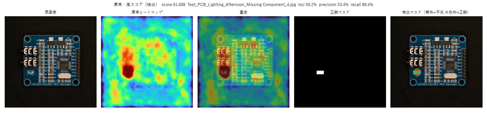
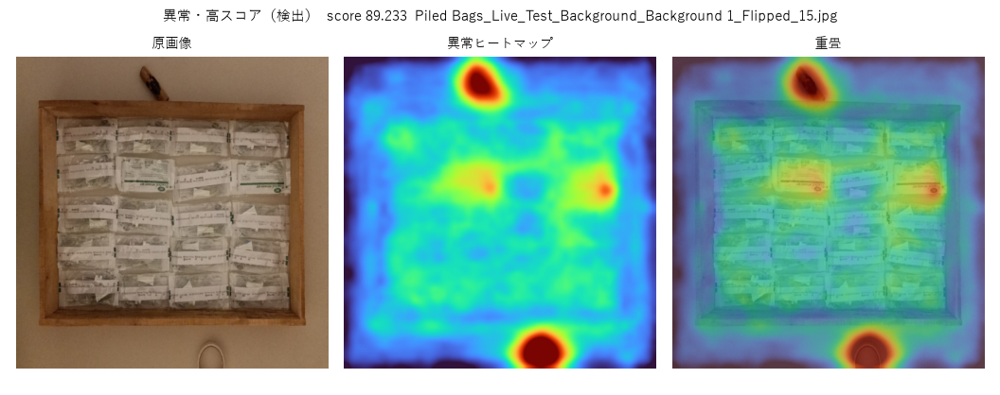
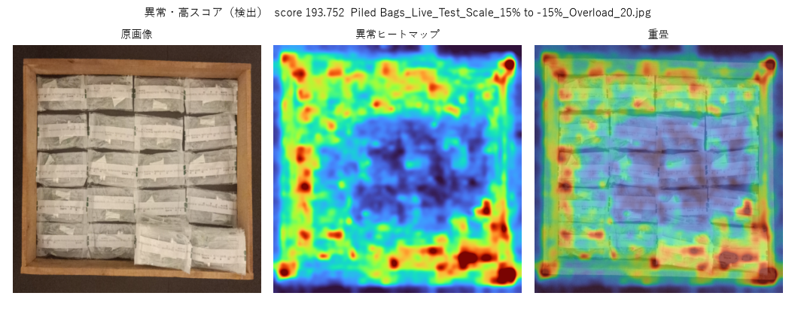

# RobustAD 再現レポート

Pemula et al., CVPRW 2025 の Table 2 のうち PaDiM と PatchCore。主結果は anomalib 2.7 の既定重み（`resnet18.a1_in1k`、`wide_resnet50_2.racm_in1k`）、入力 512、正常画像 180 枚、シード 0–4。数値の出典は `results_a1`。検出画像はシード 0。

再現の結論は、PatchCore の Metal Parts と PCB は論文の平均と ARD まで一致し、Pile of Packets の背景・スケール・影と PaDiM の一部の条件はシードを足しても埋まらない、である。

## 実験条件

学習は各 train フォルダの正常画像 180 枚すべてである。公開データは論文の train と val を一つのフォルダにまとめており、付録 Table 9 の 144/36 は使っていない。評価は test フォルダを全枚数である。PaDiM は ResNet-18 の layer1–layer3、特徴 100 次元。PatchCore は Wide-ResNet-50-2 の layer2 と layer3、coreset 比 0.1、近傍 9。center crop はない。5 シードは学習画像を固定し、特徴選択と coreset の初期点だけを変える。

Image F1 と Pixel F1 は、その撮影条件の中で F1 が最大になるしきい値である。画像スコアと画素スコアで別々に決める。ARD はターゲットについて min(0, T − S) の平均である。image drop と pixel drop はその各項である。Pile of Packets にマスクはないので画素指標はない。

## 論文 Table 2 との一致

Image AUROC（%）。平均と標準偏差は 5 シード。mean はドメイン間、セルの ± はシード間。

| 設定 | 今回 mean | 論文 mean | 差 | 今回 ARD | 論文 ARD | 判定 |
|---|---:|---:|---:|---:|---:|---|
| Metal Parts / PaDiM | 70.63 ± 18.51 | 72.30 ± 17.99 | -1.67 | -18.35 | -17.37 | 平均は近い |
| Metal Parts / PatchCore | 85.93 ± 7.18 | 85.93 ± 6.94 | 0.00 | -4.03 | -4.09 | 一致 |
| PCB / PaDiM | 39.32 ± 37.78 | 41.79 ± 34.76 | -2.47 | -72.81 | -69.85 | 平均は近い |
| PCB / PatchCore | 72.34 ± 16.79 | 72.38 ± 16.50 | -0.04 | -28.76 | -28.74 | 一致 |
| Packets / PaDiM | 66.75 ± 18.31 | 65.72 ± 19.56 | +1.03 | -38.38 | -39.70 | スケールが外れる |
| Packets / PatchCore | 77.22 ± 20.34 | 78.08 ± 19.14 | -0.86 | -27.29 | -26.28 | 3 ドメインが外れる |

PatchCore の標準偏差は多くのセルで 1 ポイント未満である。Pile of Packets の Background は 46.00 対 51.23、Scale は 81.68 対 75.34、Shadows は 79.22 対 84.31 で、論文の標準偏差 0.22–0.58 を超える。PaDiM の PCB Lighting は 4.91 ± 0.58 対 10.41 ± 7.40、Rotation は 22.02 ± 18.73 対 31.79 ± 12.98 である。こちらの標準偏差が論文より小さく、低い側に寄っている。Packets の PaDiM Scale は 58.58 ± 4.41 対 51.34 ± 4.79 で、上側に外れる。

Metal Parts と PCB の PatchCore は、ドメイン単位でも 1 ポイント前後に収まる。いちばん大きいのは PCB Shadows の -1.14 と Metal BG1 の -1.05、BG2 の +1.07 である。

## 変動要因

image drop はソースからの低下だけを数え、改善は 0 である。スケールと視点移動は画像スコアを落とし、画素の順位は比較的残る。値は 5 シード平均（%）。完全な表は `results_a1/summary.txt` の「変動要因」。

| 要因 | 代表 | Image AUROC | Image F1 | image drop | Pixel AUROC | Pixel F1 | pixel drop |
|---|---|---:|---:|---:|---:|---:|---:|
| スケール | Metal PaDiM | 39.04 | 58.59 | -45.65 | 88.58 | 0.91 | -9.56 |
| スケール | Metal PatchCore | 80.90 | 69.70 | -6.93 | 97.61 | 17.70 | 0.00 |
| スケール | Packets PatchCore | 81.68 | 81.03 | -18.27 | — | — | — |
| 視点移動 | Metal PaDiM Position | 60.65 | 61.69 | -24.04 | 93.12 | 2.80 | -5.02 |
| 視点移動 | PCB PatchCore Position | 67.50 | 62.80 | -28.80 | 90.24 | 37.27 | -7.24 |
| 視点移動 | Packets PatchCore Rot+pos | 61.63 | 61.37 | -38.33 | — | — | — |
| 照明 | Metal PatchCore | 96.59 | 90.29 | 0.00 | 98.23 | 25.32 | 0.00 |
| 照明 | PCB PaDiM | 4.91 | 60.00 | -95.09 | 84.22 | 0.40 | -10.70 |
| 背景 | Packets PatchCore | 46.00 | 60.49 | -53.95 | — | — | — |
| 影 | PCB PatchCore | 45.55 | 62.35 | -50.75 | 93.34 | 2.88 | -4.14 |

### 画素 ARD

Metal Parts の PatchCore は画素 AUROC がどの条件でもソース（96.93）以上で、画素 ARD は 0.00 である。画像 ARD は -4.03 なので、スケールや背景で画像判定は落ちても、欠陥画素の順位は残っている。PCB の PatchCore は画素 ARD -3.62、PaDiM は Metal -4.01、PCB -11.94 である。画素 AUROC 自体は 80 から 99 と高く、落ちるのは F1 である。欠陥が数画素で、平滑化した異常マップが周囲まで広がるためである。

## 検出画像

シード 0 の各条件について、高スコアの異常、低スコアの異常、高スコアの正常、低スコアの正常を `results_a1/vis` に保存している。黄枠が予測マスク、水色枠が正解、緑が一致、赤が過剰検出、青が見逃しである。しきい値はその条件の画素 F1 最大である。

### 局所欠陥は順位が合っていて、輪郭は太い

Metal Parts / PatchCore / SD の高スコア例（`Live_Multiple_Porosity`）は画像スコア 66.9、画素 IoU 0.17、recall 0.88、precision 0.17 である。欠陥の位置には反応し、予測領域が正解より広い。同じフォルダの低スコア欠け（Multiple Chipping）は IoU 0 で、しきい値の上に画素が残らない。ソースの画素 F1 は 5 シード平均 23.60 である。

PCB / PatchCore / Rotation の欠け部品（Missing Component、回転 5%）は IoU 0.42、recall 0.97 である。欠陥の面積が金属の巣穴より大きいと、同じ近傍スコアでも輪郭が正解に近づく。この条件の画素 F1 は 45.08 で、今回の画素検出ではいちばん高い部類である。

### スケールと照明では、部品全体が異常に見える

Metal Parts / PaDiM / Scale のシード 0 は image AUROC 33.60、画素 F1 0.26 である。高スコアの欠け例は recall 1.0 でも precision 0.001 で、予測が部品の広い範囲を覆う。画像スコアは 299 まで上がり、正常との順位が崩れる。5 シード平均の image drop は -45.65 である。画素 AUROC は 88.58 残るので、欠陥画素はまだ相対的に高い。F1 最大のしきい値では使い物になるマスクにならない。

PCB / PaDiM / Lighting のシード 0 は image AUROC 4.13、image F1 60.00 である。この 60 は全画像を異常にしたときの値で、precision は 90/210、recall は 1 である。分離するしきい値がない。画素側は recall 0.70 の例でも precision 0.02 で、照明の変化が広い領域を持ち上げる。同じ Lighting の PatchCore は image AUROC 74.38、画素 F1 40.19 で、局所特徴の方が照明に耐える。

### 個数と背景はマスクがなく、ヒートマップの場所で読む

Pile of Packets のソースでは、過積載の高スコア画像が余分な袋の位置を赤くする。PatchCore の SD は image AUROC 99.96、image F1 99.33 である。Background は 46.00 まで落ち、高スコア例のスコアは 89 前後でも正常と混ざる。ヒートマップは袋の欠けより背景面に反応する。Rot+pos は 61.63 で論文の 61.74 と揃うが、画像 F1 は 61.37 まで落ち、視点が変わると個数の差がスコアの大小に結びつかない。

## 考察

再現の本体は PatchCore の局所欠陥である。Metal Parts の平均 85.93 は論文と同じ数字で、ARD も -4.03 対 -4.09 である。PCB も平均 72.34 対 72.38、ARD -28.76 対 -28.74 である。解像度 512、crop なし、180 枚、ドメイン対応、画像スコアの定義は、この範囲では論文の手続きと合っている。

PaDiM は平均が 1 から 2 ポイント以内でも、セルは論文の乱数幅の中に収まるものと、こちらの標準偏差が小さくて偏るものがある。特徴 100 次元の選び方が実行ごとに変わるため、小数第 2 位までの一致は論文が公開していない乱数列がないと決まらない。狙えるのは平均と、標準偏差より大きい偏りの有無である。

画素 AUROC が高く画素 F1 が低いのは、評価が壊れているのではなく、欠陥の面積とマップのぼかしの関係である。Metal Parts の PatchCore は画素 ARD が 0 で、シフト後も欠陥画素の順位はソース以上である。画像 ARD が -4 なのは、最大値や近傍再重み付けで作る画像スコアが、スケールと背景で正常側に寄るからである。

torchvision の ImageNet-1K 重み（`results_tv`）は、PaDiM の PCB 平均を 40.97 まで論文の 41.79 に寄せた。同じ重みは、すでに合っていた PatchCore を離す。Metal BG2 は 69.93（論文 83.50）、PCB の照明から位置は約 10 ポイント低く、Packets の Rot+pos は 95.54（論文 61.74、既定重みでは 61.63）である。論文の PatchCore は torchvision より、今回の racm 重みに近い。

## ディスカッション

しきい値を各テスト条件で F1 最大にしているため、F1 は検査用の動作点である。ソースで決めたしきい値をターゲットへ固定すると、シフト後の F1 はさらに下がる。ロバスト性の動作点として読むなら、その固定が次の測定である。

Pile of Packets の Background、Scale、Shadows は標準偏差より大きい系統差である。シードを足しても埋まらない。個数や大きさの異常は、局所パッチ距離より画像スコアの集約（近傍 9 の再重み付けと、ぼかしたマップの最大値のどちらを使うか）に敏感である。論文が参照する anomalib の版はこの点が未記載である。

PCB PaDiM の Lighting と AWB は AUROC が 5 前後で、Image F1 の 60 と 50 は「すべて異常」の下限である。検出性能として 60 点あるわけではない。報告するときは precision と recall を併記する必要がある。

学習枚数は 180 枚である。付録の 144/36 で一度試した Pile of Packets は、背景が約 45、スケールが約 80 のままで、今回の系統差は分割では説明できなかった。Metal Parts の test0 は異常 51 枚で、論文の 50 枚より 1 枚多い状態のまま全ファイルを使っている。
